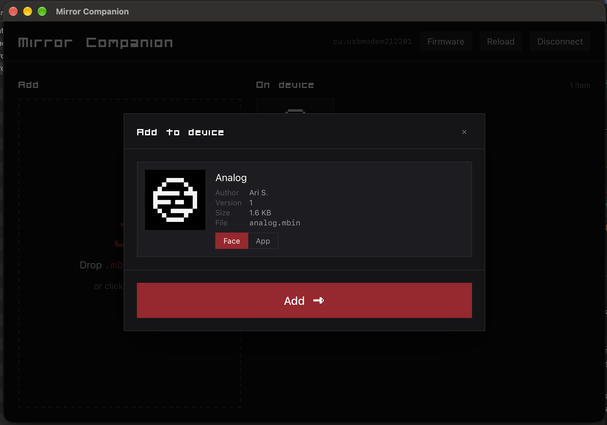

# Mirror Watch Companion

A small desktop app for managing a Mirror OS (Zephyr-based firmware) device over its USB connection. Add and remove watch faces and apps, and update the device firmware.



Built with [tinyjs](https://tinyjs.app), Alpine.js and Tailwind CSS. macOS and Linux only.

## Build

Requires [just](https://github.com/casey/just) and Node.js.

```sh
just setup        # install tinyjs (once)
npm install       # install frontend dependencies (once)
just build        # build the app into dist/
```

To run it in development with hot reload:

```sh
just dev
```

`just clean` removes `dist`, `node_modules` and `.build`.

## Usage

1. Plug in the device and pick its `cu.*` serial port.
2. Drop `.mbin` files into the window and choose whether each is an app or a face.
3. Use **Firmware** in the header to upload a signed `.bin` and reset the device.
